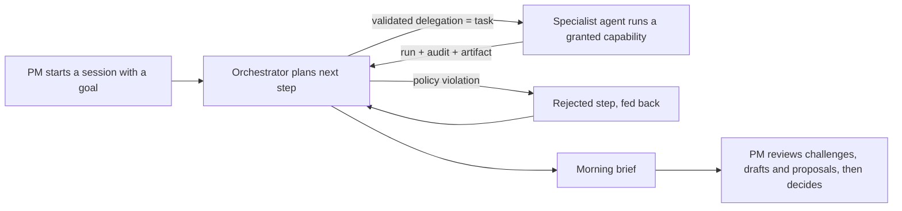

# Agent orchestration: sessions, specialists and human gates

The agent layer from [`MULTI_AGENT_PLAN.md`](../MULTI_AGENT_PLAN.md) steps 2–4. A PM asks for work; the
orchestrator plans it and delegates every step to a registered specialist through the task runtime; specialists
leave immutable, source-linked outputs; the PM decides.

## How a session runs

- `POST /sessions {vehicle, market, goal, provider, started_by}`: only a human starts (and stops) a session;
  API checks and database triggers refuse `ai:` and `system:` identities.
- **Planner.** `openai` asks the model for one next step at a time with strict Structured Outputs, given the
  goal, recorded scope context (source mix, top requirements, open reviews, connector availability), the roster
  with each agent's granted capabilities and input fields, and the step history with results.
  `reference` is a labelled deterministic plan for offline use.
- **Code, not the prompt, enforces policy.** Every proposed step must name an existing active agent, a capability
  granted to it and an input object without `actor`, `vehicle`, `market` or `session_id`. Violations are
  recorded as `rejected` steps and fed back to the planner. Step budget (default 12) and the per-run OpenAI
  call cap apply. Paused agents cannot act.
- **Delegation is a real task.** Requested by `ai:agent:orchestrator`, assigned to the agent and executed by the
  runtime, so each step has a task id, run ids, audit events and the agent's own identity on its outputs.
- Decisions are not capabilities. No agent can approve, reject, postpone, switch a rubric or send a message.
  The session always ends with a morning brief.
- Steps are append-only; artifacts are immutable (database triggers).

## Specialists added

| Agent | Capability | Output (artifact) | Gate |
| --- | --- | --- | --- |
| Challenger (A2) | `agents.challenge_requirement` | Rule-based objections (source concentration, no public corroboration, conflicts, undated evidence, assumed targets, unspecific title, grade, unmeasured factors, scope drift, sample bias) plus OpenAI counterarguments whose quotes must match the linked evidence verbatim; verdict `hold_for_evidence` / `proceed_with_caveats` / `no_objection` | PM resolves |
| Research planner (A1) | `agents.research_brief` | Studies proposed for the gaps the latest challenges found, with affected requirements, plus coverage warnings | PM and research owner decide |
| Comms drafter (A3) | `agents.draft_communications` | Engineering, market (NSC), board and sales drafts from the exact version, score and decision status; `sent: false`, no send operation | Human sends outside the system |
| Orchestrator (A0) | `agents.morning_brief` | Headline, linked lines (new sources, open reviews, decisions awaiting, challenger holds, research, failed tasks) and counts, all from recorded data | — |

The feedback analyst also runs the NHTSA connector and the trend scout the web research connector
([multi-source evidence](public-sources.md)). Read the outputs with `GET /artifacts` and `GET /sessions/{id}`;
MCP exposes `start_agent_session`, `get_agent_session`, `list_agent_sessions` and `list_agent_artifacts`.

## Measured on G60 / US (11 October 2026, multi-source database)

| Planner | Duration | Delegations | Agents used | Rejected by policy | Failed steps | Tokens |
| --- | ---: | ---: | ---: | ---: | ---: | ---: |
| Reference | 4.5 s | 9 | 7 | 0 | 0 | 0 |
| OpenAI (`gpt-6-luna`, agents on OpenAI) | 273 s | 11 | 8 | 1 | 1 | 77,026 |

In the OpenAI session the planner named an agent by its full id (rejected, then accepted after normalising
ids), and its first `pipeline.assess_updates` with OpenAI analysis failed a grounding check over the 5,301-record
scope; it retried deterministically and continued. The planner now defaults whole-scope reanalysis to the
deterministic analyzer. The three AI challenges kept every counterargument quote (0 ungrounded) and cited NHTSA
complaints, recalls and owner-forum records alongside BMW feedback. No decision was recorded by either session.

## Limits

- Sessions run in an API worker thread. A restart interrupts a running session; at startup it is closed as
  `failed` with its completed steps and artifacts kept. Resume is not implemented.
- The OpenAI planner is slow (about 15 s per step); the reference plan is the fast path for demos and tests.
- Actor identities are local declarations under the prototype contract, not authenticated enterprise users.
